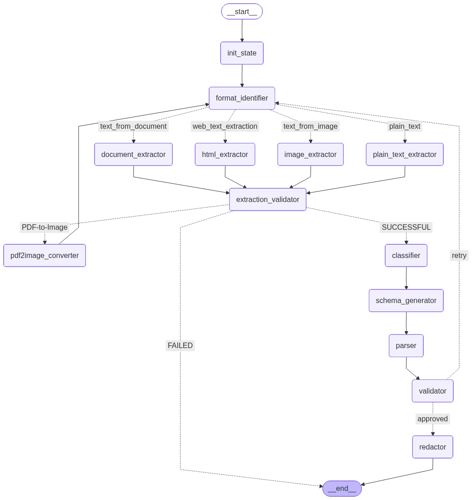

# Agentic Document Parser

An agent-based document understanding system designed to extract **reliable, validated, and schema-guided structured data** from heterogeneous documents such as PDFs, scanned documents, images, and application forms.

The system is implemented as a **stateful agent graph** where each node performs a deterministic responsibility—format detection, extraction, classification, schema generation, parsing, validation, retry control, and **mandatory PII redaction**.  
The design prioritizes **correctness, traceability, and safety** over single-pass extraction.

---
## Graph Visualization


## Core Capabilities

- Format-aware extraction routing
- Automatic detection of scanned PDFs
- PDF-to-image fallback for OCR-based extraction
- Document-type classification via an agent
- Dynamic schema generation based on extracted text
- Runtime Pydantic model creation for guided parsing
- Validation-based scoring and retry mechanism
- Explicit retry limits to prevent infinite recursion
- Mandatory PII redaction on structured output
- Deterministic execution using a shared agent state

---

## System Overview

The application is structured as an **agentic workflow graph**.  
Each node reads from and writes to a shared state object, ensuring controlled data flow and debuggability across the pipeline.

---

## Application Flow

### 1. Format Identifier

The workflow begins at the `format_identifier` node.

Responsibilities:
- Inspects the input `file_path`
- Determines the file type (PDF, image, etc.)
- Routes execution to the appropriate extraction pipeline

This node also serves as the **central retry entry point** for the system.

---

### 2. Extraction Pipeline

Based on the detected format:
- Text-based PDFs are processed using a PDF text extraction library
- Images are routed directly to the OCR pipeline

The extracted content is stored in the agent state as `raw_text`.

---

### 3. Extraction Validator

Performs a sanity check on the extracted content.

Logic:
- If `raw_text` is non-empty, execution proceeds
- If `raw_text` is empty:
  - If the file is a PDF:
    - The document is assumed to be a scanned PDF
    - The workflow routes to the `pdf2image_converter`
  - If the file is not a PDF:
    - The workflow terminates early, as recovery is not possible

---

### 4. PDF to Image Converter

This node:
- Converts each page of the PDF into image files (PNG)
- Creates temporary image files
- Overwrites `file_path` in the agent state
- Sets the `triggered_pdf2image` flag to `true`

Control is routed back to `format_identifier`, enabling OCR-based extraction.

To prevent redundant looping:
- Once `triggered_pdf2image` is set, the extraction validator will not re-trigger this conversion again.

---

### 5. Document Classifier Agent

Consumes:
- `raw_text`

Produces:
- A probable document type (e.g., scholarship form, PAN card, Aadhaar card, receipt)

This classification informs downstream schema generation, validation, and redaction rules.

---

### 6. Schema Generator Agent

Inputs:
- Document type
- Raw extracted text

Output:
- A dynamically generated JSON schema describing expected fields and data types

The schema is derived from the extracted content itself, ensuring relevance and minimizing overfitting to static templates.

---

### 7. Parser Agent

The generated JSON schema is converted into a **Pydantic model at runtime**.

Purpose:
- Enforce strict structural constraints
- Prevent hallucinated or loosely structured outputs
- Guide the LLM toward schema-compliant field population

The result is a strongly typed structured output rather than free-form JSON.

---

### 8. Validator Agent

Inputs:
- Document type
- Raw extracted text
- Structured output

Behavior:
- Evaluates semantic consistency between extracted values and source text
- Computes a validation score based on the proportion of meaningful key-value pairs

Decision:
- If the score meets or exceeds the user-defined threshold:
  - The output is approved
  - Execution proceeds to the redaction stage
- If the score falls below the threshold:
  - Execution is routed back to `format_identifier` for retry

---

### 9. Retry Control and Recursion Safety

Retries are governed by the `iterations` field in the agent state.

- `iterations` uses a reducer
- Incremented on every execution of `format_identifier`
- Initialized to `0` in `init_state`

Once the maximum retry count is reached:
- The workflow terminates safely
- Infinite recursion is structurally impossible

---

### 10. Redactor (Mandatory)

The redactor is a **mandatory final stage** in the pipeline.

Inputs:
- Document type
- Structured output

Responsibilities:
- Identify and redact personally identifiable information (PII)
- Apply document-type-specific redaction rules
- Ensure that no sensitive data leaves the system unprotected

For government-issued identity documents:
- Redaction behavior follows explicit system rules
- User intent is respected where applicable, but redaction is never skipped

The final output of the system is **always redacted structured data**.

---

## Agent State Design

The workflow relies on a shared, typed state object.

Key fields include:
- `file_path`
- `file_type`
- `raw_text`
- `document_type`
- `schema`
- `structured_output`
- `validation_score`
- `iterations`
- `triggered_pdf2image`

---

## `init_state`

The `init_state` node initializes the workflow state.

Responsibilities:
- Populate required state keys
- Initialize `iterations = 0`
- Ensure deterministic and predictable execution from the first node onward

---

## Project Structure

```text
AGENTIC-DOCUMENT-PARSER/
│
├── .idea/                      # IDE-specific configuration
├── .streamlit/                 # Streamlit configuration
├── .venv/                      # Virtual environment
│
├── data/                       # Input documents for parsing
├── output/                     # Final redacted structured outputs
├── prompts/                    # Prompt templates used by agents
├── schemas/                    # Base and generated schema definitions
│
├── src/
│   ├── __pycache__/            # Python cache
│   ├── __init__.py
│   │
│   ├── _flow.md                # Workflow / graph documentation
│   ├── agent_schema.py         # Shared agent state schema
│   ├── orchestrator.py         # Agent graph orchestration logic
│   ├── init_state.py           # Initial state construction
│   │
│   ├── format_identifier_agent.py      # File format detection and routing
│   ├── extractor_agent.py              # Format-specific text extraction
│   ├── extraction_validator_agent.py   # Sanity checks on extracted text
│   ├── pdf_to_image_agent.py            # PDF to image conversion for OCR
│   ├── classifier_agent.py              # Document type classification
│   ├── schema_generator_agent.py        # Dynamic JSON schema generation
│   ├── parser_agent.py                  # Runtime Pydantic-based parsing
│   ├── validator_agent.py               # Validation scoring and retry logic
│   ├── redactor_agent.py                # Mandatory PII redaction layer
│   │
│   └── resources.py                     # Shared utilities and resources
│
├── temp/                       # Temporary files (e.g., PDF-to-image outputs)
│
├── .env                        # Environment variables (not committed)
├── .env_example                # Sample environment configuration
├── .gitignore
├── .python-version             # Python version pinning
│
├── frontend.py                 # Streamlit-based user interface
├── pyproject.toml              # Project metadata and dependencies
└── README.md                   # Project documentation
```
